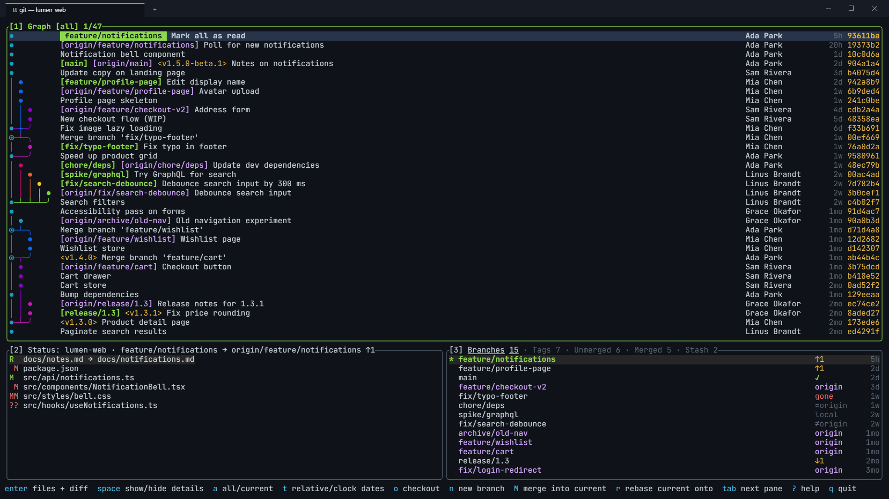

<p align="center">
  
</p>

<h1 align="center">tt-git</h1>



A terminal git client in Rust ([ratatui](https://ratatui.rs)), inspired by
[lazygit](https://github.com/jesseduffield/lazygit) and
[gitui](https://github.com/gitui-org/gitui), with:

- **A GitLens-style commit graph as the main view.** It shows `git log --all`
  with stable, colored lanes and badges for branches, remotes and tags.
  Press `a` to switch between all branches and just the current branch (plus
  its upstream).
- **A status pane** like lazygit's files panel: stage, unstage, discard,
  commit, amend and stash. Press `enter` on a file to see its changes
  fullscreen and stage, unstage or discard them a hunk or a line at a time.
  It also handles merge/rebase/cherry-pick conflicts.
- **One branch list for local and remote branches**, sorted by recent
  activity (commits, fetches, checkouts). If you check out a branch that only
  exists on a remote, tt-git creates the local tracking branch for you
  without asking.
  Two more tabs list the branches merged and not yet merged into the
  project's primary branch (or any base branch you pick). On those tabs the
  graph shows only the selected branch, from where it branched off to where
  it was merged back in.
- **Plugins built the same way as [herdr](https://herdr.dev/docs/plugins/):**
  plain subprocesses with a TOML manifest. Plugins can add actions, event
  hooks, startup commands and terminal panes, and they talk back through the
  `tt-git` CLI or a JSON socket. See [docs/plugins.md](docs/plugins.md).

```
╭[1] Graph [all] 1/5─────────────────────────────────────────────────────────────────────────────╮
│●    [side] side experiment                                             Test User      2h b66   │
│◉─╮   main  <v1.0> Merge 'feature'                                      Test User      3h 59f   │
││ ●  [feature] feature work                                             Test User      1d 788   │
│● │  main work                                                          Test User      1d f75   │
│●─╯  base                                                               Test User      2d b29   │
╰────────────────────────────────────────────────────────────────────────────────────────────────╯
╭[2] Status: repo · main → origin/main ↑1───────╮╭[3] Branches 3─────────────────────────────────╮
│ M src/app.rs                                  ││* main            ✓          2h                │
│?? notes.md                                    ││  feature         local      1d                │
╰───────────────────────────────────────────────╯╰───────────────────────────────────────────────╯
 enter files + diff  space show/hide details  a all/current  n new branch  tab next pane  ? help
```

Press `space` on a commit to open its details in place of the bottom row,
or `enter` to open it fullscreen as changed files beside a diff.
The layout is configurable; see [docs/configuration.md](docs/configuration.md#layout).

## Install

You need git 2.31 or newer on `PATH`.

Linux (x64, arm64) and macOS (Apple Silicon):

```sh
curl -fsSL https://github.com/ThirtyTech/tt-git/releases/latest/download/install.sh | sh
```

Windows (x64, arm64):

```powershell
powershell -ExecutionPolicy Bypass -c "irm https://github.com/ThirtyTech/tt-git/releases/latest/download/install.ps1 | iex"
```

Both install the latest release; set `TTGIT_VERSION` (such as `v0.2.0`) for
a specific one, or `TTGIT_INSTALL_DIR` to change where it goes. You can also
download an archive from
[Releases](https://github.com/ThirtyTech/tt-git/releases).

To build from source:

```sh
cargo install --path crates/tt-git
tt-git            # in a repository, or: tt-git path/to/repo
```

## Keys

Press `?` for the keys of the focused pane (type to search them, `esc` to
close), or `:` (or `ctrl+p`) for the
command palette, which lists built-in commands and plugin actions.

| Where | Key | Does |
|---|---|---|
| anywhere | `1` `2` `3` `4` / `tab` `shift+tab` | focus graph / status / branches / details |
| | `ctrl+h` `ctrl+j` `ctrl+k` `ctrl+l` | focus the pane to the left / below / above / right |
| | `+` | zoom: the graph, or details if focused, fullscreen and back |
| | `j` `k` `↑` `↓`, `ctrl+d` `ctrl+u`, `g` `G` | move, page, top/bottom |
| | `P` / `p` | push (sets upstream on first push) / pull |
| | `ctrl+r` | refresh |
| | `:` `ctrl+p` | command palette |
| | `q` | quit |
| graph | `enter` | the commit fullscreen: changed files on the left, the selected file's diff on the right (`j`/`k` pick a file, `pgup`/`pgdn` scroll, `esc` or `space` back) |
| | `space` | show / hide the commit's details (they replace the bottom row) |
| | `esc` | hide details (with details hidden: clear the filter) |
| | `a` | all branches ↔ current branch |
| | `t` | dates as age (`3h`) ↔ local date and time (`2026-10-17 01:30 PM`) |
| | `f` | filter: only one author's commits, or the commits that changed a file or folder (`tab` in the panel switches between the two; both can be set) |
| | `n` | new branch at the selected commit (`tab` in the dialog: create it in a worktree) |
| | `M` / `r` / `C` | merge into current / rebase current onto / cherry-pick |
| | `c` | copy the commit hash |
| branches | `enter` `space` | check out (remote-only branches get a tracking branch) |
| | `n` `d` `R` | new (`tab` in the dialog: create it in a worktree under `.worktrees/`) / delete (asks before force-deleting unmerged) / rename |
| | `f` | `fetch --all --prune` |
| | `/` | filter as you type (`esc` clears) |
| | `]` `[` | next / previous tab: all branches, tags, unmerged into the base branch, merged into it, and stashes (once there are any) |
| | `b` | pick the base branch (default: the project's primary branch) |
| | `M` / `r` | merge / rebase onto the selected branch |
| | `c` | copy the branch name |
| status | `space` | stage / unstage the file |
| | `enter` | open the file's changes fullscreen to stage them by hunk or line (below) |
| | `a` | stage everything (or unstage, if all staged) |
| | `d` | discard changes to the file (asks first) |
| | `c` / `A` | commit / amend keeping the message |
| | `s` | stash: everything, only what's staged, everything but leave staged changes in place, or just the selected file (`tab` in the dialog picks; the message is optional) |
| | `C` / `X` | continue / abort a merge, rebase or cherry-pick |
| stash tab | `space` / `a` | pop / apply the selected stash (pop drops it once applied) |
| | `d` | drop it (asks first) |
| | `n` | new branch from it at the commit it was made on (`git stash branch`) |
| | `enter` | show what it holds fullscreen, untracked files included (`esc` back) |
| details | `}` | show / hide the commit's changed files below the diff (`j`/`k` pick a file); fullscreen puts them on the left |
| | `o` | open the link in view with a plugin link handler |
| | `esc` `space` | close details |
| staging | `j` / `k` | next / previous hunk (or changed line) |
| | `space` | stage the selection, or unstage it on the staged side |
| | `tab` | switch between the unstaged and staged changes |
| | `a` | pick single lines instead of whole hunks, and back |
| | `v` | start or end a range of lines |
| | `d` | discard the selection from the working tree (asks first) |
| | `c` | commit what's staged |
| | `esc` | back to the status pane |

The mouse also works: click a pane or row to focus and select it, use the
wheel to scroll the pane under the pointer, and `ctrl`+click a link in the
details pane. Every binding can be changed; see
[docs/configuration.md](docs/configuration.md).

## How the panes work

Every pane reads from the `git` CLI, never from a library that parses the
repository itself, so tt-git always agrees with the git you run by hand
(hooks, config, mailmap, worktrees, partial clones). Each git call runs with
`-c color.ui=never -c core.quotepath=false -c log.showSignature=false
-c core.pager=cat`, `GIT_TERMINAL_PROMPT=0` and `GIT_OPTIONAL_LOCKS=0`, so
output is always plain, a credential prompt never hangs the UI, and reads
never take the index lock away from a git command you're running.

### Graph

**What it shows.** `git log --topo-order` of every ref (`--all`, minus
`refs/stash`), newest first, with one row per commit: lanes, ref badges, the
subject, author, relative date and short hash. On a narrow pane the author
goes first, then the rest of the metadata, so the subject stays readable.

**Lanes.** The layout (`tt-git-graph`) is GitLens/GitKraken style: once a
line has a column it keeps it, so branches run straight down instead of
shifting sideways as other lines start and end.

- A commit takes the leftmost lane that's waiting for it. Other lanes waiting
  for it end there and join it with `╯`. A commit nobody is waiting for is a
  branch tip and takes the first free column.
- The first parent continues in the commit's column. Each further parent
  joins a lane already waiting for it, or opens a new one.
- A column freed in a row isn't reused in that same row, so a line never
  looks like it passes straight through a merge.
- Each new tip and merge lane gets the next of 8 colors. Merges are `◉`,
  other commits `●`.
- Only `max_lanes` columns (default 16) are drawn and stored; anything wider
  collapses into `…`. Rows are packed at 2 bytes a column.

The layout only looks at the current lane state, never ahead, so rows are
built while `git log` is still streaming.

**Badges.** The checked-out branch is ` name ` on green (` HEAD ` when
detached), local branches `[name]`, remote branches `[origin/name]`, tags
`<v1.0>`. Symbolic refs like `origin/HEAD` are skipped, since they only
repeat another badge. Badges that don't fit are dropped before the subject is.

**All or current (`a`).** All is `--exclude=refs/stash --all`. `--all` is
used instead of `HEAD` because it still works on a detached HEAD and doesn't
fail on an unborn branch. Current is `HEAD` plus its upstream (from
`rev-parse --symbolic-full-name @{upstream}`), so you can see what you'd
push or pull.

**Loading.** Commits stream in batches of 1,000, up to `max_commits`
(default 20,000). The old rows stay on screen until the first new batch
arrives, so a refresh never flashes empty, and a load that's been replaced
kills its `git log` instead of finishing it. When the selection gets within
200 commits of the end, the next `max_commits` load with `--skip`, and the
existing lanes carry on. That only happens if the refs it started from are
unchanged; tt-git checks that by fingerprinting the ref files (`HEAD`,
`refs/`, `packed-refs`, `shallow`, worktree HEADs) without running git.
Otherwise it reloads from the top. The same fingerprint means a fetch that
brings nothing new doesn't reload the graph at all.

**Filtering by author or file (`f`).** The panel has two tabs, Author and
File (`tab` switches); you can set one or both, and a commit has to match
both.

- *Authors* come from `git log --use-mailmap --format='%aN <%aE>' --all`,
  counted per person and listed with the most commits first. Because of
  `.mailmap`, one person who committed under several emails is one entry.
- *Files* come from `git ls-files`, with each folder listed (ending in `/`)
  just before the first file in it, so you can pick `src/components/` and
  see every commit that touched anything under it.
- *Matching.* Typing narrows the list. Entries that contain what you typed
  (ignoring case) come first, then ones that only match it as a subsequence
  (`apcmp` finds `app/components/`), each group in its original order.
- *Deleted files.* `git ls-files` only knows files that still exist, so if
  nothing matches on the File tab, `enter` uses what you typed as the path.
  You can still find the history of a file that's gone.
- *Clearing.* When a part of the filter is set, the first entry in its tab
  is "Any author" or "Any file", which clears just that part. With details
  closed, `esc` in the graph clears the whole filter.

The filtered log adds `--use-mailmap --fixed-strings --author=<Name <email>>`
for an author. `--use-mailmap` makes git match the same mapped identity the
list showed, and `--fixed-strings` means names with regex characters in them
match literally. The match is git's own: a case-sensitive substring of the
author line. For a path, it adds `-- <path>` and `--parents`, which turns on
git's parent rewriting: each commit's parent becomes the nearest ancestor
that also touched the path, so the lanes still join up into a readable
graph instead of hundreds of disconnected dots. An author filter can't
rewrite parents that way, so a line ends where the next commit is by someone
else and the next match starts a new lane. Renames aren't followed (no
`--follow`), and git's default history simplification applies.

A filtered load comes back in one batch rather than streaming, because which
parents drop out is only known once the whole log is in. The title shows the
filter, for example `Graph [all · author Ada · file src/] 3/120`.

**Merged and unmerged branches in the graph.** On the branches pane's
Unmerged and Merged tabs, the graph shows only the selected branch; see
[the branch history](#the-branch-history-in-the-graph) below. The author/file
filter is set aside while it does and comes back when you leave those tabs.

**Zoom.** `+` puts the graph fullscreen and back. With the graph fullscreen,
`space` shows details beside it at full width.

### Details

**What it shows.** The selected commit, a commit's changed files, a stash, a
working-tree file's diff, or text from a plugin. It follows the selection in
the graph and the branches pane. Nothing loads while details is hidden, and
at most one load of each kind is in flight: hold `j` and tt-git loads only
the commit you stop on, not every commit you passed.

**The commit.** One `git show --stat --patch --diff-merges=first-parent -M`
with the full message, author, committer and parents. `--diff-merges=first-parent`
shows a merge as what it brought into the branch, which is what you usually
want to review, and `-M` shows renames as renames. Long diffs stop at 5,000
lines with a count of what's left, so a huge generated file can't stall the
UI.

**Changed files (`}`, or `enter` in the graph).** A list of the files
(`git show --name-status -M`, renames as `old → new`) and the selected
file's diff, loaded one file at a time and cached while the view is open.
Fullscreen puts the list on the left; otherwise it sits under the diff.
While the next commit's files load, the old list stays up so the layout
doesn't jump.

**Links (`o`, `ctrl`+click).** tt-git finds the first `http(s)://` link in
view and hands it to the first plugin whose `[[link_handlers]]` pattern
matches it, for example to open a pull request or a ticket. With no matching
plugin, it says so rather than guessing which program should open it.

### Branches

The pane has tabs, switched with `]` and `[`: **Branches**, **Tags**,
**Unmerged**, **Merged**, and **Stash** once there's a stash. Each tab keeps
its own cursor. The title shows a count per tab, and the base branch on the
tabs that compare against it: `Branches 12 · Tags 3 · Unmerged 4 (origin/main) · Merged 9`.

Everything on every tab comes from one `git for-each-ref` over
`refs/heads refs/remotes refs/tags`. It returns each ref's target, date,
upstream, ahead/behind counts, author and subject in one process, so the
pane never runs a `rev-list` per branch. A full refresh is 6 to 8 git
processes however many branches you have.

**One row per branch.** Local and remote branches are grouped, so `main`,
`origin/main` and `upstream/main` are a single row instead of three:

1. Each local branch is a row.
2. A remote branch joins the local branch that tracks it (so local `x`
   tracking `origin/feature-x` is one row), else the row with the same name,
   else it becomes a remote-only row.
3. `origin/HEAD` and other symbolic refs are skipped.

Remote names that contain `/` are handled: the longest configured remote
name that prefixes the ref wins.

**Sorted by activity, not name.** A row's activity is the newest of:

- the tip commit date of each of its refs,
- the last entry in each ref's reflog, which covers commits, resets,
  rebases and fetches that moved the remote branch, and
- for local branches, the last time you checked it out, from
  `checkout: moving from A to B` entries in `HEAD`'s reflog.

Reflogs are read straight from `.git/logs/` and only from the end of the
file, so this costs no git processes. The checkout time comes from the
reflog entry, not the commit, since checking out an old branch today should
put it at the top. The branches you're working with are at the top without
scrolling or typing.

**The status column: branches with no remote.** Each row says how it relates
to its remote:

| Shown | Means | How it's decided |
|---|---|---|
| `local` | Local only: nothing on any remote | No upstream, and no remote branch of the same name |
| `origin` / `origin,upstream` | Remote only: you don't have it locally | No local branch; lists every remote that has it |
| `✓` | In sync with its upstream | Upstream set, 0 ahead and 0 behind |
| `↑2` `↓3` `↑2↓3` | Ahead / behind its upstream | git's own `%(upstream:track)` counts |
| `gone` (red) | Its upstream was deleted on the remote | Upstream set, but git reports it gone, usually after `fetch --prune` |
| `=origin` | Not tracking, but `origin` has the same name at the same commit | No upstream configured |
| `≠origin` | Not tracking, and `origin`'s same-named branch is elsewhere | No upstream configured |

`gone` is checked first, then tracking, then the rest. The column is meant
to answer "can I delete this?" and "did I forget to push this?" at a
glance: `local` has never been pushed, `gone` was merged and deleted
upstream, and `=origin` is safe to set an upstream for. Remote-only names
are also colored like remote branches.

**Checking out (`enter`/`space`).** A local branch runs `git switch <name>`.
A remote-only branch runs `git switch -c <name> --track <remote>/<name>`
without asking, preferring `origin` when several remotes have it: checking
out a remote branch nearly always means "give me a local copy of it".

**Merged and Unmerged tabs.** These list the branches merged and not yet
merged into the *base branch*, like
`git branch -r --merged origin/main` / `--no-merged origin/main`, but with
each tip's subject, author (through `.mailmap`) and date.

- *Merged* means reachable: `git for-each-ref --merged=<base>`, so a branch is
  merged when its tip is the base or one of the base's ancestors. A branch
  that was squash-merged or rebase-merged has a tip that isn't, so it stays
  on Unmerged.
- If the base is a remote branch, only branches on that remote are compared;
  if it's local, only local branches. That keeps one row per branch and
  compares like with like.
- The base branch itself, and the long-lived names in `safe_branches`
  (default `master`, `main`, `production`, `prod`), are never listed: they'd
  be noise on both tabs and you never want to delete them by accident.
- Unmerged hides names containing anything in `unmerged_exclude` (default
  `archive`), the way people add `grep -v archive` to the git alias.
- Both are sorted by commit date, newest first.

**The base branch.** It's detected as the project's primary branch: whatever
a remote's `HEAD` points at (`origin` first), else the first of `main`,
`master`, `development`, `develop` or `trunk` on a remote, then locally.
`b` picks another one; tt-git saves it as `tt-git.baseBranch` in the repo's
own git config, so each project remembers its own and nothing is written to
your global config. If the saved branch is later deleted, detection takes
over again.

#### The branch history in the graph

On Unmerged and Merged, the graph shows only the selected branch, so you can
see what it contains without the rest of the history in the way:

1. `git merge-base --is-ancestor <tip> <base>` says whether it's merged.
2. If it is, `git rev-list --first-parent --ancestry-path <tip>..<base>`
   finds the base commit that merged it in. If that commit isn't a merge,
   the branch was fast-forwarded and only its tip is shown.
3. The branch's own commits are `git log --first-parent <tip> ^<merge's first parent>`
   (or `^<base>` if unmerged). First-parent leaves out commits it pulled in
   from other branches, so you see only the work done on it.
4. The parent of its oldest commit is where it branched off.
5. The graph draws the branch as a loop off the base: the fork commit
   "(branched off origin/main)" at the bottom, then the branch's commits,
   then the merge "(merged into origin/main)". For an unmerged branch the
   base's current tip takes the merge's place, so you can see how far the
   base has moved on. Base commits in between are left out.

Going back to the Branches tab, or `a` in the graph, shows the full graph
again.

### Tags

**What it shows.** Every tag, newest first by its creation date (the tagger
date for an annotated tag, the commit date for a lightweight one), with the
tag message's subject (or the commit's) and how old it is: `3d`, `2w`,
`4mo`.

**How far each release is from the base.** Tags are treated as releases,
and the five newest tags also show how far they are from the base branch:

| Shown | Means |
|---|---|
| `↓12` | The base has 12 commits since this tag: 12 commits unreleased |
| `↑3` | The tag has 3 commits the base doesn't, e.g. a fix tagged on a release branch |
| `↑3↓12` | Both |
| `✓` | The tag is the base's tip; nothing unreleased |

So the newest tag's `↓` is "commits since the last release", and its age is
"how long since the last release". The counts are against the base branch,
not against `HEAD` or the previous tag, so they don't change as you switch
branches. Tags are ordered by date; versions in names aren't parsed.

On git 2.41 and later, all five come from one
`git for-each-ref --format=%(ahead-behind:<base>)`. On older git, each is
`git rev-list --left-right --count <base>...<tag>`, and tt-git remembers
the old version so it doesn't try the new form again. Only five are compared
because each one walks history, which gets slower the older the tag is;
older tags show a blank.

Selecting a tag moves the graph to its commit. `n` makes a branch from it,
`M`/`r` merge or rebase onto it, `d` deletes it locally (`git tag -d`, after
asking) and `c` copies its name.

### Stash

The stash list, newest first, shown once there's a stash. `space` pops,
`a` applies and keeps it, `d` drops, `n` makes a branch from it, and `enter`
shows what it holds in details. `s` in the status pane stashes. The list is
only loaded when a stash reflog exists, so a repo without stashes pays
nothing for it.

### Other branch actions

- `/` filters the current tab as you type: a case-insensitive subsequence
  match, so `flp` finds `feature/login-page`. `esc` clears it.
- `f` runs `git fetch --all --prune`. `--prune` is what removes deleted
  remote branches and turns their local branches `gone`.
- `d` on a local branch runs `git branch -d`. If git says it isn't fully
  merged, tt-git asks again before `git branch -D`. On a remote-only branch
  it asks, then runs `git push <remote> --delete <branch>`. The checked-out
  branch can't be deleted.
- `n` makes a branch from the selection with `git switch -c`; `tab` in the
  dialog makes it in a worktree under `.worktrees/<name>` instead
  (`git worktree add -b`), adding `.worktrees/` to `.git/info/exclude` so it
  never shows as untracked.
- `R` renames a local branch (`git branch -m`).
- `M` merges the selection into the current branch (`git merge --no-edit`);
  `r` rebases the current branch onto it, non-interactively. Both ask first.
- `c` copies the name to the clipboard with OSC 52, which also works over
  SSH.

### Status

**What it shows.** `git status --porcelain=v2 -z --branch --untracked-files=all`,
one row per file with the same two-letter code as `git status -s` (index,
then working tree): `M ` staged, ` M` modified, `??` untracked, `UU`
conflicted, and `old → new` for renames. Staged-only files are green, files
with unstaged changes red, conflicts in the error color. Porcelain v2 is
used because its format is stable across git versions and `-z` keeps odd
file names intact.

**The title.** `Status: <repo> · <branch> → <upstream> ↑1 ↓2`, plus
`MERGING`, `REBASING`, `CHERRY-PICKING` or `REVERTING` while one is in
progress. The upstream and ahead/behind come from the same `--branch` output,
so they cost no extra git call. The selected file's diff (staged, then
unstaged) shows in details.

**Actions.**

- `space` stages a file with changes (`git add`), else unstages it
  (`git restore --staged`, or `git rm --cached` before the first commit,
  when there's no `HEAD` to restore from). On a conflicted file, staging
  marks it resolved.
- `a` stages everything (`git add -A`), or unstages everything if it's all
  staged already.
- `d` asks, then discards: an untracked file is deleted, a new file removed
  with `git rm -f`, a rename undone on both paths, and anything else reset
  with `git restore --source=HEAD --staged --worktree`.
- `c` commits what's staged. The message goes to `git commit -F -` on stdin,
  so multi-line messages and ones starting with `-` are safe. With nothing
  staged it says so instead of opening the prompt.
- `A` amends the last commit with what's staged, keeping its message
  (`git commit --amend --no-edit`).
- `s` stashes, with a choice of everything, only what's staged, keeping
  what's staged, or just the selected file.

**Merges, rebases and cherry-picks.** tt-git tells which one is in progress
from the files git leaves behind (`rebase-merge/`, `rebase-apply/`,
`MERGE_HEAD`, `CHERRY_PICK_HEAD`, `REVERT_HEAD`), with no git call, and shows
a banner row: `REBASING: stage fixes · C continue · X abort`. Resolve a file,
stage it with `space`, then:

- `C` continues. It refuses while a file is still conflicted. A merge is
  finished with `git commit --no-edit`; the others with `git <op> --continue`.
  Both run with `core.editor=:`, so git keeps the message it prepared rather
  than opening an editor inside the TUI.
- `X` asks, then runs `git <op> --abort`.

Both work from any pane.

### Staging hunks and lines

`enter` on a file in the status pane opens its changes fullscreen: unstaged
on the left and staged on the right when the terminal is at least 140
columns wide, one above the other when it's narrower. A side with no changes
shrinks to its title. `tab` switches sides.

- In hunk mode `j`/`k` move a hunk at a time. `a` switches to line mode,
  where they step through changed lines only, skipping context. `v` starts
  a range.
- `space` stages the selection from the unstaged side, or unstages it from
  the staged side. `d` discards it from the working tree, after asking.
- After each change both sides reload and the cursor lands on what came
  next. The view closes by itself once the file has no changes left.

**How a selection becomes a patch.** Each side is
`git diff [--cached] --no-ext-diff --no-textconv --no-renames --no-relative
--src-prefix=a/ --dst-prefix=b/`, pinning every option that would change
the output's shape, so the patch tt-git builds from it always applies.
tt-git then writes a patch with only the picked lines:

- An unpicked `+` line is dropped when staging; an unpicked `-` line becomes
  context. Unstaging and discarding apply the patch in reverse, so there
  it's the other way round. Lines you didn't pick stay as they are.
- Hunk headers are recomputed from the lines written, and each later hunk's
  start moves by what the earlier ones added or removed. That's why tt-git
  doesn't need `git apply --recount`, and full context is kept so the patch
  applies only where it should.
- CRLF line endings and `\ No newline at end of file` are kept exactly.
- Picking part of a new or deleted file turns it into a change to the file
  rather than creating or deleting it. An untracked file is first marked
  with `git add -N` so a part of it can be staged; if the patch then fails,
  that's undone.

The patch goes to `git apply --cached` (stage), `--cached -R` (unstage) or
`-R` (discard) on stdin. Binary files, conflicted files and untracked files
over 256 KiB can't be split, and the view says to stage the whole file.
While a patch is applying, further keys wait: what's on screen is out of
date until the new diffs arrive.

### Plugin panes

A plugin pane runs the plugin in a pseudo-terminal and draws its screen
inside tt-git. A split pane takes details' place; overlays and popups float
over the layout. `ctrl+\` or `f12` leaves the pane. Panes keep no scrollback,
since they only ever show the live screen. See [docs/plugins.md](docs/plugins.md).

### Refreshing

With `watch = true` (the default), tt-git watches the working tree and
`.git` and refreshes after 300 ms of quiet:

- `.git/index` changes reload the status.
- `HEAD`, `refs/`, `packed-refs`, `logs/` and `FETCH_HEAD` changes reload
  the branches and status, and the graph only if the refs it starts from
  actually moved.
- Lock files, `objects/` and hooks are ignored.
- A change in the working tree reloads the status, unless git ignores that
  path. tt-git reads the same rules git does (every `.gitignore`,
  `info/exclude`, `core.excludesFile`) and re-reads them when one of them
  changes, so a build writing into `node_modules/`, `dist/` or `target/`
  doesn't reload the status over and over.

`ctrl+r` refreshes everything, and so does the end of every git command
tt-git runs. Refreshes coalesce: if several are asked for while one runs,
exactly one more follows.

## Memory and speed

tt-git is built to sit open all day next to your editor without costing
anything while you aren't using it:

- It redraws only when something changed. The 250 ms tick redraws only when
  a relative date on screen would change, plugins reloaded, or a plugin
  pane shows a cursor.
- It runs on a single-threaded async runtime. git work runs on a blocking
  thread pool whose threads exit once they've been idle a few seconds, so
  an idle tt-git has a handful of threads.
- Each kind of load keeps at most one git process in flight, with only the
  newest request waiting. Holding `j` through the graph doesn't start a
  `git show` per row, and a graph load that's been replaced is killed
  rather than finished.
- Commits are compact: hashes are 32-byte arrays rather than strings,
  author names and emails are shared between commits, and the graph stores
  only the lanes it draws, at 2 bytes a lane.
- A refs refresh is 6 to 8 git processes however many branches and tags
  there are; reflogs and the ref fingerprint are read from files directly.

### An example: a large React codebase

Measured on a long-lived React and TypeScript web app:

| | |
|---|---|
| History | 28,145 commits on all refs (27,281 on `HEAD`), since 2017, 42 authors |
| Refs | 810: 160 local branches, 303 remote branches, 341 tags |
| Tracked files | 3,209 (1,111 `.tsx`/`.jsx`, 1,637 `.ts`/`.js`) |
| Packed objects | 246k objects, 103 MiB |
| Working tree | with an installed `node_modules/` (ignored) |

tt-git release build, Windows 11, git 2.50, `--no-plugins`, default config
(so the graph loads the newest 20,000 commits), sampled every second for
45 seconds after starting, with no keys pressed:

| | |
|---|---|
| Peak working set | 30.5 MiB |
| Working set, idle | 28.2 to 29.2 MiB |
| Private bytes, idle | 17.9 to 18.9 MiB |
| Threads | 11 while loading, 5 at idle |
| CPU time | 0.17 s to load, 0.31 s total over 45 s |
| git processes at idle | none |

Refs, status and the first 20,000 commits of the graph had loaded by the
first sample, one second in; the extra threads wind down over the next
20 seconds. The binary is 6.4 MiB.

## Plugins

```sh
tt-git plugin install owner/repo          # from GitHub; shows what will run and asks first
tt-git plugin link ./my-plugin            # local development
tt-git plugin list
```

[docs/plugins.md](docs/plugins.md) covers the manifest format, environment
variables, events, panes, the socket API and the CLI.
[examples/plugins](examples/plugins) has working examples.

## Development

You need Rust 1.89 or newer (the workspace uses edition 2024) and git 2.31
or newer on `PATH`.

### Running from source

```sh
cargo run -p tt-git                        # the repository in the current directory
cargo run -p tt-git -- path/to/repo        # another repository
cargo run -p tt-git -- --no-plugins        # without plugins or the API socket
cargo run -p tt-git -- --config dev.toml   # with a different config file
cargo run -p tt-git -- plugin list         # subcommands work the same way
```

Everything after `--` goes to tt-git rather than Cargo.

A dev build reads your real config and installed plugins. To keep it
separate, point the config and state directories somewhere under `target/`:

```sh
export TTGIT_CONFIG_DIR=$PWD/target/dev/config
export TTGIT_STATE_DIR=$PWD/target/dev/state
```

```powershell
$env:TTGIT_CONFIG_DIR = "$PWD\target\dev\config"
$env:TTGIT_STATE_DIR = "$PWD\target\dev\state"
```

### Logs

The UI owns the terminal, so tt-git logs to `<state>/logs/tt-git.log`
instead (see [docs/configuration.md](docs/configuration.md#logs) for where
`<state>` is). `TTGIT_LOG` sets the level as an
[`EnvFilter`](https://docs.rs/tracing-subscriber/latest/tracing_subscriber/filter/struct.EnvFilter.html)
string, default `info`. Follow the log from a second terminal:

```sh
TTGIT_LOG=debug,tt_git_tui=trace cargo run -p tt-git
tail -f target/dev/state/logs/tt-git.log   # PowerShell: Get-Content target\dev\state\logs\tt-git.log -Wait
```

### Working on plugins

`plugin link` uses a plugin straight from its directory, so edits take
effect without reinstalling:

```sh
cargo run -p tt-git -- plugin link examples/plugins/open-on-github
```

[docs/plugins.md](docs/plugins.md#testing-a-plugin) covers testing plugins.

### Tests

```sh
cargo test --workspace            # unit, integration, in-process UI and PTY end-to-end tests
cargo insta review                # after intentional UI changes
cargo bench -p tt-git-graph       # graph layout on a synthetic 100k-commit history
```

Tests run against real git in throwaway repositories with a fake `$HOME`
and fixed dates (`Sandbox`). UI flows drive the real app on ratatui's
`TestBackend` and wait until the app is idle after each key (`TestDriver`),
so they never sleep. A few end-to-end tests run the real binary in a
pseudo-terminal, ConPTY on Windows, via [termlens](https://crates.io/crates/termlens).

### Before you push

CI checks formatting and lints, then runs the tests on Linux, macOS and
Windows with [cargo-nextest](https://nexte.st) and
[cargo-insta](https://insta.rs). To run the same checks locally:

```sh
cargo install cargo-nextest cargo-insta   # once
cargo fmt --all --check
cargo clippy --workspace --all-targets -- -D warnings
cargo insta test --workspace --test-runner nextest --check --unreferenced reject
cargo test --workspace --doc
```

`--check` fails on any snapshot that doesn't match, and
`--unreferenced reject` fails on snapshot files no test uses, so delete
those when you remove a test.

### Crates

| Crate | What |
|---|---|
| `tt-git-core` | git CLI runner, parsers, unified branch list, write operations |
| `tt-git-graph` | lane layout for the commit graph (no git or UI dependencies) |
| `tt-git-plugin` | manifest, registry, runtime, install/GC, NDJSON socket |
| `tt-git-tui` | the ratatui app: panes, keymap, modals, PTY plugin panes |
| `tt-git` | the binary and CLI |
| `tt-git-testkit` | sandbox repos, the in-process `TestDriver`, plugin fixtures |
